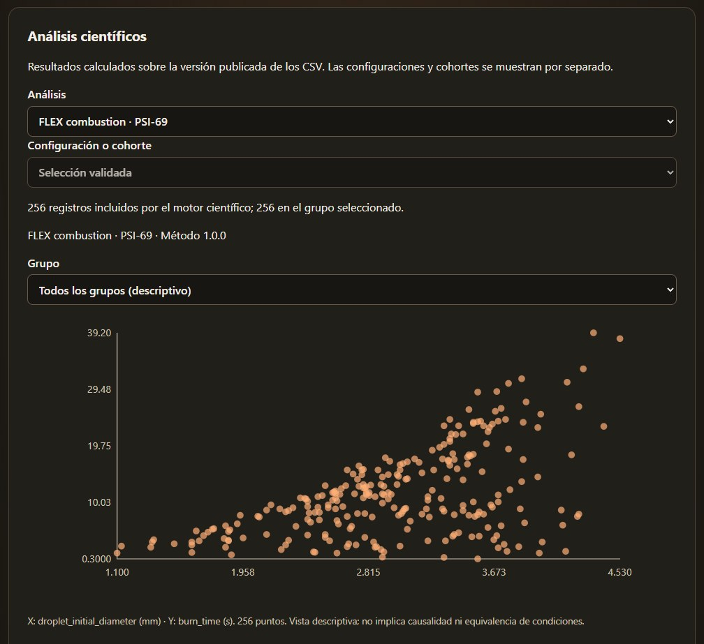
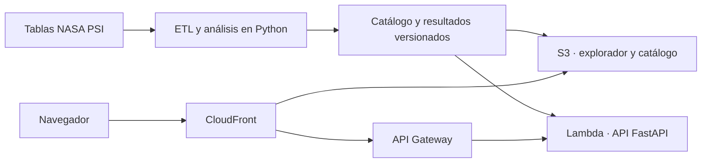

<p align="center">
  
</p>

<h1 align="center">Pyrogravity</h1>

<p align="center">
  <strong>Explora la combustión en microgravedad con datos de la NASA.</strong><br>
  Flame in Freefall · Proyecto para el NASA Space Apps Challenge
</p>

<p align="center">
  <a href="https://d1spxqlrdcakje.cloudfront.net/"></a>
  <a href="https://github.com/fredcastillo/Pyrogravity/actions/workflows/ci.yml?query=branch%3Amain"></a>
  <a href="docs/README.md"></a>
</p>

<p align="center">
  <a href="data/"></a>
  <a href="app/"></a>
  <a href="frontend/"></a>
  <a href="infrastructure/aws/README.md"></a>
</p>

## Explora la demo

La demo reúne **21 tablas experimentales de 19 investigaciones de la NASA**. Puedes explorar las filas, revisar sus unidades y seguir la fuente hasta el archivo original. Los análisis muestran la metodología y las advertencias de calidad junto a los resultados.

1. Abre **Tablas de NASA** y elige una investigación para consultar sus registros.
2. En **Análisis científicos**, selecciona BASS-II, FLEX, Flame Design, CFI-G o SPICE para explorar sus gráficos, grupos y criterios de inclusión.
3. En **Comparar ensayos**, prueba FLEX con `1, 2, 3` y compara el tiempo de combustión en segundos. También puedes comparar las mediciones de oxígeno inicial de BASS-II.

<p align="center">
  <a href="https://d1spxqlrdcakje.cloudfront.net/#science-title"></a>
  <br><sub>FLEX · Diámetro inicial de la gota y tiempo de combustión. Captura de la demo pública.</sub>
</p>

## Datos y procedencia

Cada análisis parte de tablas experimentales versionadas. El manifiesto registra los archivos de origen y su SHA-256. La demo muestra la fila de origen junto a las mediciones y enlaza la investigación en NASA PSI. [Manifiesto de datos](data/source_manifest.csv) · [Referencias científicas](docs/references/README.md)

| Análisis | Qué explora | Fuente NASA |
| :--- | :--- | :--- |
| BASS-II | Cambios en la concentración de CO₂ durante ensayos con sólidos | [PSI-25](https://psi.nasa.gov/physci/repo/data/investigations/PSI-25) |
| FLEX | Diámetro de gota y duración de la combustión según el combustible y el fin del ensayo | [PSI-69](https://psi.nasa.gov/physci/repo/data/investigations/PSI-69) |
| Flame Design | Cambios de presión en configuraciones de llama normal e inversa | [PSI-10](https://psi.nasa.gov/physci/repo/data/investigations/PSI-10) |
| CFI-G | Duración de combustión por configuración de llama y código de terminación | [PSI-159](https://psi.nasa.gov/physci/repo/data/investigations/PSI-159) |
| SPICE | Caudales de aire y combustible según la boquilla y el combustible | [PSI-107](https://psi.nasa.gov/physci/repo/data/investigations/PSI-107) |

## Arquitectura



Ese es el recorrido de la **demo pública**. El **Command Center** es la interfaz React en desarrollo. Su integración con la API científica y el motor de IA con citas tiene su propio seguimiento. [Frontend](frontend/README.md) · [Estado de IA](docs/IA.md) · [Operación en AWS](infrastructure/aws/README.md)

## Ejecutar en local

Desde la raíz del repositorio, con **Python 3.12** y un entorno virtual activo:

```sh
python -m pip install -r data/requirements.txt -r infrastructure/demo/requirements.txt uvicorn
python -m infrastructure.demo.export_data
python -m uvicorn app:api --app-dir infrastructure/demo --host 127.0.0.1 --port 8000
```

Abre el [explorador local](http://127.0.0.1:8000/). Con el servidor activo, usa otra terminal para comprobar la demo y ejecutar las pruebas científicas.

```sh
python infrastructure/aws/smoke.py http://127.0.0.1:8000
python -m pytest data/tests -q
```

Para trabajar en el Command Center, sigue los comandos del frontend. Los contratos de la API y los planes técnicos están en la documentación del repositorio. [Frontend](frontend/README.md) · [OpenAPI](docs/api/openapi.json) · [Documentación](docs/README.md)

## Equipo y contribuciones

| Integrante | Área |
| :--- | :--- |
| [Stanley Camacho](https://github.com/StanleyCM) | ETL y análisis científico |
| [Johan Gabriel Vasquez](https://github.com/Johanvasquezdev) | IA, recuperación de evidencia y citas |
| [Gregori Jimenez](https://github.com/GregoriEJimenezDev) | API FastAPI, contratos e integración |
| [Bryant Romano](https://github.com/Brlamafia) | Command Center y visualizaciones |
| [Fred Sneyder Castillo](https://github.com/fredcastillo) | QA, seguridad y trazabilidad científica |
| [Michael Robles](https://github.com/iClexi) | Docker, CI/CD y operación en AWS |

Las contribuciones se integran mediante pull requests hacia `main`. Incluye cómo reproducir tu cambio y vincula las fuentes si modificas datos o análisis. [Guía de contribución](CONTRIBUTING.md) · [Issues](https://github.com/fredcastillo/Pyrogravity/issues)
