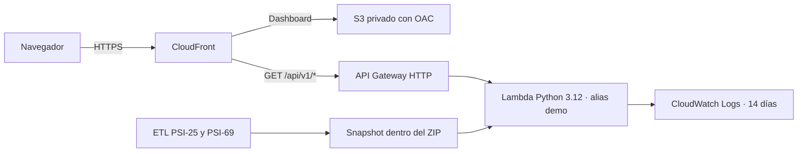

# Demo de Pyrogravity en AWS

La entrada pública `/` publica el frontend React de `frontend/`. `prepare_site.py`
conserva el catálogo y los comparadores bajo los assets de la misma versión;
los enlaces del frontend apuntan a ese catálogo. CI prueba la distribución que
se publica y CloudFront usa rutas inmutables identificadas por el SHA de Git.
El modo estático de React utiliza datos reales de la API; los prototipos visuales
con datos locales continúan disponibles en el entorno de desarrollo.

El catálogo de la demo se genera a partir de todas las tablas validadas por el ETL de `data/`. Muestra las filas con datos, los encabezados originales, las unidades declaradas y la fuente de NASA. El comparador interactivo admite FLEX, con el tiempo de combustión en segundos, y BASS-II, con el oxígeno inicial calibrado en porcentaje por volumen.



El snapshot y el catálogo se regeneran al compilar. El comparador grafica valores exactos y conserva registros parciales o sin evidencia en la tabla. Los números decimales viajan como cadenas para conservar su precisión. La fila y el hash SHA‑256 permiten rastrear una medición hasta el CSV del repositorio. Git conserva los bytes de esos CSV, incluido el fin de línea. El exportador ejecuta el ETL en un directorio temporal y lee los hashes de las tablas que acaba de generar.

## Ejecutar en local

Desde la raíz, con Python 3.12 y el entorno virtual del equipo:

```powershell
python -m pip install -r data/requirements.txt -r infrastructure/demo/requirements.txt uvicorn
python -m pytest data/tests -v
python -m infrastructure.demo.export_data
python -m uvicorn app:api --app-dir infrastructure/demo --host 127.0.0.1 --port 8000
```

Abre [localhost:8000](http://127.0.0.1:8000). En otra terminal, ejecuta `python infrastructure/aws/smoke.py http://127.0.0.1:8000` para verificar la cobertura del catálogo, las comparaciones, la procedencia y la evidencia insuficiente.

## Publicar

El script de despliegue requiere PowerShell 7. Usa un perfil con credenciales temporales. El perfil administrador crea o actualiza las dos pilas de CloudFormation. La función de ejecución solo escribe en su propio grupo de logs.

```powershell
python infrastructure/aws/build.py
pwsh -File infrastructure/aws/deploy.ps1 -Profile tu-perfil-aws
```

El script carga el ZIP con su SHA‑256 como clave, crea una versión de Lambda y actualiza el alias `demo`. Publica primero los archivos de interfaz y después `index.html`, limpia la caché de CloudFront y verifica la URL pública. Con una instalación de AWS CLI fuera del PATH, añade `-AwsExecutable 'A:\AWS CLI V2\aws.exe'`. Puedes elegir otro nombre con `-StackName` y otra región con `-Region`.

La demo usa dos buckets privados con versionado, un alias de Lambda y tres rutas GET de datos públicos. API Gateway limita inicialmente a 5 solicitudes por segundo con una ráfaga de 10, como objetivo de regulación. La API regional también acepta solicitudes directas a estas rutas públicas. Tanto el dashboard como las consultas quedan disponibles a través de HTTPS en CloudFront. El despliegue no requiere adjuntar Lambda a una VPC.

## Publicación desde GitHub

Cada actualización de `main` ejecuta el CI. Si pasa la verificación general, el job **Publicar la demo en AWS** descarga el ZIP y los archivos web verificados en esa ejecución. Comprueba que el commit sigue vigente, publica la versión de FastAPI, actualiza el sitio de CloudFront y prueba la URL pública. Las ramas de trabajo ejecutan el CI de los PR.

GitHub Actions solicita una sesión temporal de AWS por OIDC. La variable de repositorio `PYROGRAVITY_AWS_DEMO` contiene un JSON con `roleArn` y `templateUrl`. El rol solo puede publicar en los buckets de esta demo, actualizar su pila con la versión aprobada de la plantilla e invalidar su distribución. La lista de permisos se administra en AWS.

La portada React se abre en `/` y el enlace **Inicio** del Atlas vuelve a esa ruta. La función `pyrogravity-legacy-home` de CloudFront, asociada en `viewer-request` al comportamiento por defecto, redirige las antiguas portadas del directorio de publicaciones a `/`. Su código está en `redirect_legacy_home.js`. La interfaz consulta el catálogo científico y envía preguntas a `POST /api/v1/ai/query` en el mismo origen. Durante la publicación se prueba el contrato y su respuesta de evidencia insuficiente. La activación del proveedor real y del corpus se prepara según [el runbook de IA](../../docs/operacion-ia.md).

### Publicación opcional del motor privado

El job de IA prueba sus contratos, permisos PostgreSQL y adaptador privado; después
construye `private-ai.zip` y comprueba que su handler importe desde el ZIP extraído.
En `main` conserva ese paquete como `pyrogravity-private-ai-<commit>`. El despliegue
descarga el artefacto de la misma ejecución después de la verificación general;
no reconstruye código ni recibe las credenciales de Cohere o Supabase.

Para incorporar el servicio privado al CD, el operador agrega **ambas** claves a
`PYROGRAVITY_AWS_DEMO`, conservando `roleArn` y `templateUrl`:

```json
{
  "privateStackName": "pyrogravity-ai-private",
  "privateTemplateUrl": "https://BUCKET.s3.us-east-1.amazonaws.com/templates/ARCHIVO.yaml?versionId=VERSION"
}
```

Es un fragmento para añadir al JSON existente, no una sustitución completa. La URL
debe identificar la versión de la plantilla privada revisada y autorizada en IAM.
Si faltan las dos claves, continúa la publicación pública existente. Si solo se
configura una, el workflow falla antes de escribir en AWS. La pila privada debe
existir y estar estable; este flujo no crea secretos, roles, corpus ni la pila.

El operador debe ampliar el rol OIDC **antes** de habilitar esas claves:

- `cloudformation:DescribeStacks` en el ARN exacto de la pila privada y
  `cloudformation:UpdateStack` sobre ese ARN, condicionado a su URL aprobada y
  sin permitir un `RoleARN` alternativo.
- Lectura de la versión aprobada de la plantilla y lectura/escritura en
  `private-ai/*` del bucket de artefactos. No conceder escritura en `templates/*`.
- `lambda:GetFunctionConfiguration` en el ARN exacto de la función privada para
  verificar su SHA-256, estado y finalización.
- Las operaciones de lectura y `lambda:UpdateFunctionCode` que CloudFormation
  necesita sobre esa función, restringidas mediante `aws:CalledVia` a
  `cloudformation.amazonaws.com`. No conceder actualización directa de código,
  acceso a secretos, escritura IAM ni modificación del corpus al workflow.

`publish.ps1` conserva las identidades de backend e ingesta, actualiza primero el
ZIP privado y verifica el `CodeSha256` real. A continuación publica backend y web
bajo la misma exclusión mutua. Un paquete privado idéntico se verifica sin volver
a publicarlo. Si falla la comprobación posterior, recupera índice, backend y
paquete privado anteriores. La recuperación privada comprueba que la pila aún
contiene el paquete de esta ejecución y está estable para evitar sobrescribir una
actualización ajena; una recuperación que no pueda completarse queda registrada
como advertencia y el job conserva el fallo.

Este control verifica el paquete y el recorrido público existente. La aceptación
de credenciales, permisos remotos, documentos y resultados científicos se ejecuta
con `scripts/verify_live_ai.py` una vez que el operador configura los secretos.
No confundir una importación correcta del ZIP con una consulta real a Cohere.

Pruebas locales de publicación y reconciliación (requieren PowerShell 7):

```sh
python -m unittest discover -s infrastructure/aws/tests -v
```

Las pruebas ejecutan el script de publicación real con AWS simulado y verifican
orden, rechazo de hash incorrecto, recuperación de ambos paquetes, ausencia de
publicación pública tras un fallo privado y compatibilidad con la configuración
que solo publica la demo.

Los archivos de `infrastructure/demo/web`, las rutas de FastAPI en `infrastructure/demo/app.py` y los datos usados por el exportador se publican con este flujo. Para cambiar la infraestructura, un administrador aplica las plantillas con `deploy.ps1` y registra la nueva versión aprobada antes del siguiente despliegue, actualizando la política y la variable de GitHub.

## Operación y siguientes cambios

### Publicación y recuperación automáticas

`ci.yml` prueba datos, PostgreSQL/RLS, API y navegador antes de publicar un commit de
`main`. `sync-demo.yml` comprueba la versión pública cada cinco minutos mediante
`reconcile.py`. GitHub puede retrasar sus horarios; el evento `push` es el camino
principal. Todo se ejecuta en GitHub y AWS aunque los equipos personales estén apagados.

Si hay una publicación pendiente, el reconciliador solicita CI, nunca publica sin
pruebas y no duplica una ejecución activa del mismo commit. Tras tres intentos de un
commit detiene los reintentos y marca un error para intervención. Un commit nuevo
tiene un nuevo presupuesto. El índice usa escritura condicional y los assets son
inmutables por commit; `publish.ps1` recupera el índice y el backend anteriores si
falla la verificación pública. Las plantillas de infraestructura siguen sujetas a
la aprobación explícita del rol OIDC: el rol de publicación no puede ampliar IAM.

### Cinco análisis trazables

`GET /api/v1/analyses` enumera `bass-ii`, `flex`, `flame-design`, `cfi-g` y `spice`.
`GET /api/v1/analyses/{id}` devuelve el resultado del catálogo de Stanley generado
en CI, con metodología, unidades, exclusiones, fuente y SHA-256. La demo no necesita
credenciales de PostgreSQL. La interfaz permite cambiar configuración, cohorte,
grupo y página. Los decimales permanecen como cadenas en el contrato; solo las
coordenadas de dibujo se convierten a números. Las gráficas no representan series
temporales cuando la fuente no las contiene.

### Alarmas y diagnóstico

`monitoring.yaml` añade seis alarmas: disponibilidad pública, HTTP 4xx, HTTP 5xx,
latencia p95, errores Lambda y throttling Lambda. EventBridge verifica la página,
la salud de la API y el catálogo cada cinco minutos. Dos sondas fallidas o ausentes
disparan disponibilidad. SNS envía fallos y recuperaciones cuando el destinatario
confirma la suscripción. Las alarmas no dependen de una visita a la página.

Los logs de acceso `/aws/vendedlogs/apigateway/pyrogravity-demo` conservan 14 días
y registran request ID, ruta, estado y tamaño; no guardan consultas, cuerpos,
direcciones IP ni cabeceras de autorización. El encabezado `X-Request-Id` de la API
permite buscar la misma solicitud. Lambda y la sonda también conservan 14 días.

`security.guard` valida controles acotados de almacenamiento, retención y Lambda;
no constituye una certificación CIS. El smoke HTTP comprueba hashes de todos los
CSV, los cinco resultados y la versión pública; `browser_smoke.py` comprueba ocho
combinaciones de análisis/cohorte, paginación y tamaños de escritorio y móvil.

### PostgreSQL de CI

El servicio PostgreSQL 17 es desechable. CI aplica las migraciones de `supabase/`,
carga los 21 datasets con el rol de ingesta, repite la carga para verificar
idempotencia y compara los cinco análisis SQL con Parquet. Comprueba que un rol
sin políticas no ve filas y que el lector de API y el cargador no pueden destruir
datos. `PYRO_TEST_DATABASE_URL` nunca debe apuntar a una base real; la prueba se
niega a migrar si ya existe el esquema `scientific`.

- Para investigar errores, revisa el grupo de logs `/aws/lambda/pyrogravity-demo-api` y prueba `/api/v1/health`. El script de verificación usa la misma URL que el navegador.
- Para volver a una versión anterior, despliega el commit correspondiente y las dependencias verificadas con el mismo comando. Los paquetes anteriores quedan en el bucket de artefactos y S3 mantiene versiones del frontend.
- Fred administra las reglas de protección de `main`. Como las actualizaciones de esa rama se publican, las reglas de revisión y CI determinan qué cambios pueden llegar al sitio.
- Gregori y Bryant integran luego el backend y el dashboard del equipo con este recorrido. Stanley conserva la procedencia y Johan añade el RAG y las citas. Para habilitar consultas en vivo, conecta Supabase y Cohere desde el servidor, limita las credenciales de Lambda a los secretos del proyecto y protege las rutas que invocan el modelo. ECR queda para cuando se empaquete el backend en contenedor.
