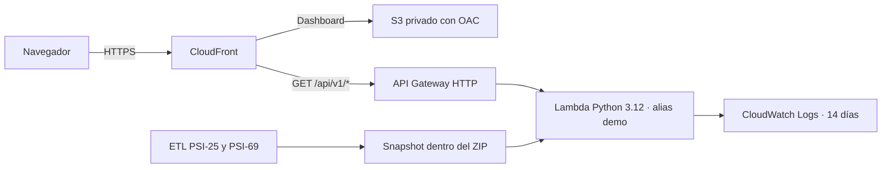

# Demo de Pyrogravity en AWS

La demo ofrece una comparación de ensayos de combustión con datos de NASA. El ETL de `data/` produce Parquet y `infrastructure/demo/export_data.py` conserva para cada medición su estado, unidad y procedencia. FLEX muestra tiempo de combustión en segundos. BASS-II muestra oxígeno inicial calibrado en porcentaje por volumen. La comparación se limita a ensayos de un mismo estudio.



El snapshot se regenera al compilar. El dashboard grafica valores exactos y conserva registros parciales o sin evidencia en la tabla. Los números decimales viajan como cadenas para conservar su precisión. La fila y el hash SHA‑256 permiten rastrear una medición hasta el CSV del repositorio. Git conserva los bytes de esos CSV, incluido el fin de línea.

## Ejecutar en local

Desde la raíz, con Python 3.12 y el entorno virtual del equipo:

```powershell
python -m pip install -r data/requirements.txt -r infrastructure/demo/requirements.txt uvicorn
python -m pytest data/tests -v
python -m data.src.etl.nasa_etl
python infrastructure/demo/export_data.py
python -m uvicorn app:api --app-dir infrastructure/demo --host 127.0.0.1 --port 8000
```

Abre [localhost:8000](http://127.0.0.1:8000). En otra terminal, ejecuta `python infrastructure/aws/smoke.py http://127.0.0.1:8000` para verificar los dos estudios, la procedencia y la evidencia insuficiente.

## Publicar

El script de despliegue requiere PowerShell 7. Usa un perfil con credenciales temporales. El perfil administrador crea o actualiza las dos pilas de CloudFormation. La función de ejecución solo escribe en su propio grupo de logs.

```powershell
python infrastructure/aws/build.py
pwsh -File infrastructure/aws/deploy.ps1 -Profile tu-perfil-aws
```

El script carga el ZIP con su SHA‑256 como clave, crea una versión de Lambda y actualiza el alias `demo`. Publica primero los archivos de interfaz y después `index.html`, limpia la caché de CloudFront y verifica la URL pública. Con una instalación de AWS CLI fuera del PATH, añade `-AwsExecutable 'A:\AWS CLI V2\aws.exe'`. Puedes elegir otro nombre con `-StackName` y otra región con `-Region`.

La demo usa dos buckets privados con versionado, un alias de Lambda y tres rutas GET de datos públicos. API Gateway limita inicialmente a 5 solicitudes por segundo con una ráfaga de 10, como objetivo de regulación. La API regional también acepta solicitudes directas a estas rutas públicas. Tanto el dashboard como las consultas quedan disponibles a través de HTTPS en CloudFront. El despliegue no requiere adjuntar Lambda a una VPC.

## Operación y siguientes cambios

- Para investigar errores, revisa el grupo de logs `/aws/lambda/pyrogravity-demo-api` y prueba `/api/v1/health`. El script de verificación usa la misma URL que el navegador.
- Para volver a una versión anterior, despliega el commit correspondiente y las dependencias verificadas con el mismo comando. Los paquetes anteriores quedan en el bucket de artefactos y S3 mantiene versiones del frontend.
- Fred administra las reglas de protección de `main`. Cuando el equipo habilite revisión y CI obligatorio, añade el rol OIDC para el trabajo de publicación y limita su confianza al repositorio y a la rama. La demo actual se publica con un perfil AWS.
- Gregori y Bryant integran luego el backend y el dashboard del equipo con este recorrido. Stanley conserva la procedencia y Johan añade el RAG y las citas. Para habilitar consultas en vivo, conecta Supabase y Cohere desde el servidor, limita las credenciales de Lambda a los secretos del proyecto y protege las rutas que invocan el modelo. ECR queda para cuando se empaquete el backend en contenedor.
